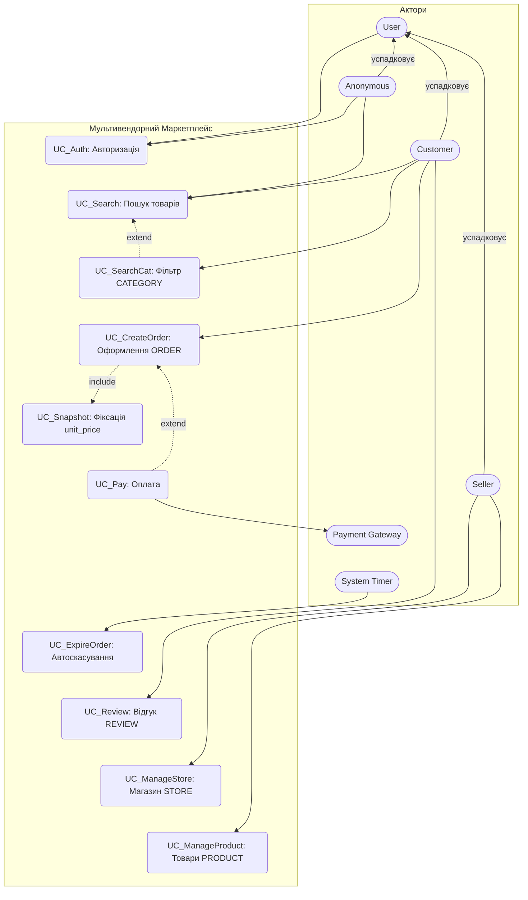

# Специфікація вимог та Use Cases маркетплейсу (Завдання 2)

## 1. Актори системи (Actors)

| Актор | Тип | Опис |
| :--- | :--- | :--- |
| **User** | Abstract | Абстрактний базовий актор (спільна автентифікація). |
| **Anonymous** | Primary | Неавторизований відвідувач; шукає товари, входить у систему. Успадковує `User`. |
| **Customer** | Primary | Покупець, який шукає товари, оформлює замовлення та залишає відгуки. Успадковує `User`. |
| **Seller** | Primary | Продавець, який керує магазином STORE та каталогом PRODUCT. Успадковує `User`. |
| **Payment Gateway** | External | Зовнішня платіжна система для обробки онлайн-транзакцій. |
| **System Timer** | Internal | Внутрішній тригер за часом; не є людиною. Запускає перевірку неоплачених замовлень. |

---

## 2. Функціональні вимоги у форматі EARS

- **EARS-01 (Ubiquitous):** Система SHALL повертати товари `PRODUCT`, що відповідають пошуковому запиту; для вибраної `CATEGORY` — товари цієї категорії та її підкатегорій. Доступно `Anonymous` і `Customer`.
- **EARS-02 (Event-driven):** WHEN покупець `Customer` підтверджує замовлення, система SHALL створювати запис `ORDER` та фіксувати знімок ціни `unit_price` у сутності `ORDER_ITEM`.
- **EARS-03 (State-driven):** WHILE замовлення перебуває у статусі `Pending`, система SHALL резервувати `ORDER_ITEM.quantity` одиниць товару, зменшуючи `PRODUCT.stock_quantity` на цю кількість.
- **EARS-04 (Optional):** WHERE покупець обирає онлайн-оплату, система SHALL ініціювати транзакцію через `Payment Gateway`.
- **EARS-05 (Unwanted Behavior):** IF `Payment Gateway` повертає статус відмови транзакції, THEN система SHALL повертати `ORDER_ITEM.quantity` до `PRODUCT.stock_quantity` (скасування резерву) та залишати `ORDER` у статусі `Unpaid`.
- **EARS-06 (Event-driven):** WHEN покупець `Customer` залишає відгук `REVIEW`, система SHALL зберігати оцінку `rating` (ціле число від 1 до 5) та коментар `comment` з прив'язкою до `PRODUCT` і `USER`.
- **EARS-08 (Event-driven):** WHEN продавець `Seller` створює або редагує `STORE`, система SHALL зберігати `name` і `description` з прив'язкою `owner_id` до `USER`.
- **EARS-09 (Event-driven):** WHEN продавець `Seller` додає або змінює `PRODUCT`, система SHALL зберігати `title`, `price`, `stock_quantity` з прив'язкою `store_id` до `STORE`, що належить продавцю.
- **EARS-10 (Unwanted Behavior):** IF продавець намагається змінити `STORE` або `PRODUCT`, який йому не належить (`STORE.owner_id` ≠ `USER.id`), THEN система SHALL відхиляти зміну.
- **EARS-11 (Event-driven):** WHEN анонімний користувач `Anonymous` надсилає `USER.email` і пароль, система SHALL автентифікувати його за `USER.password_hash` і створювати сесію з роллю `USER.role` (значення: `customer` або `seller`); IF пароль не збігається, THEN система SHALL відмовляти у вході без створення сесії.
- **EARS-12 (Unwanted Behavior):** IF `ORDER` залишається у статусі `Pending` понад 24 години без успішної оплати (`ORDER.payment_status` ≠ `approved`), THEN система SHALL змінювати `ORDER.status` на `Cancelled` і повертати `ORDER_ITEM.quantity` до `PRODUCT.stock_quantity`. *Строк 24 год — див. `docs/adr/0007-pending-order-expiry.md`.*
- **EARS-13 (Event-driven):** WHEN покупець повторює оплату `ORDER` у статусі `Unpaid`, система SHALL повторно зарезервувати `ORDER_ITEM.quantity` для кожної позиції та перевести `ORDER.status` у `Pending`; IF на складі недостатньо `PRODUCT.stock_quantity` для резерву, THEN система SHALL відхиляти повторну оплату і залишати `ORDER` у статусі `Unpaid`.
- **EARS-07 (Optional, Out of Scope):** WHERE товар доставляється за межі внутрішнього ринку, система SHALL розраховувати міжнародну митну вартість і збори. *Статус: Out of Scope, див. `trace-matrix.md`, розділ 3.*

---

## 2.1. Нефункціональні вимоги (NFR)

*Числові пороги є пропонованими значеннями і потребують узгодження із замовником (`docs/adr/0009-nfr-thresholds.md`). Журнал аудиту (NFR-10) і лічильник невдалих входів (NFR-03) зберігаються інфраструктурно, а не як сутності ERD (див. ADR-0009).*

**Безпека**

- **NFR-01 (Ubiquitous, Security):** Система SHALL зберігати `USER.password_hash` лише як результат адаптивного хешування (bcrypt, Argon2 або еквівалент) і SHALL НЕ зберігати та НЕ логувати паролі у відкритому вигляді.
- **NFR-02 (Ubiquitous, Security):** Система SHALL передавати всі дані між клієнтом і сервером лише через HTTPS (TLS 1.2 і вище).
- **NFR-03 (Event-driven, Security):** WHEN для одного `USER.email` за 15 хвилин зафіксовано понад 5 невдалих спроб входу, THEN система SHALL тимчасово блокувати вхід для цього email на 15 хвилин.
- **NFR-04 (Ubiquitous, Security/Privacy):** Система SHALL повертати персональні дані `USER.email`, `USER.phone`, `USER.first_name`, `USER.last_name` лише власнику облікового запису та адміністратору.

**Продуктивність**

- **NFR-05 (Ubiquitous, Performance):** Система SHALL повертати результати пошуку `UC_Search` за ≤ 500 мс для 95% запитів при каталозі до 100 000 `PRODUCT`.
- **NFR-06 (Ubiquitous, Performance):** Система SHALL виконувати `UC_CreateOrder` за ≤ 2 с для 95% запитів, не враховуючи час відповіді `Payment Gateway`.

**Надійність і цілісність даних**

- **NFR-07 (Ubiquitous, Reliability):** Система SHALL змінювати `PRODUCT.stock_quantity` атомарно (у межах транзакції або з блокуванням рядка), щоб за паралельних замовлень значення не ставало від'ємним.
- **NFR-08 (Ubiquitous, Integrity):** Система SHALL гарантувати, що `ORDER.total_amount` дорівнює сумі `ORDER_ITEM.quantity × ORDER_ITEM.unit_price` для всіх позицій замовлення.
- **NFR-09 (Ubiquitous, Availability):** Система SHALL бути доступною не менше 99,5% часу на місяць, виключаючи заздалегідь оголошені планові роботи.

**Спостережуваність та аудит**

- **NFR-10 (Event-driven, Auditability):** WHEN відбувається спроба входу, зміна `ORDER.status` або зміна `PRODUCT.stock_quantity`, THEN система SHALL записувати в журнал аудиту `USER.id`, тип події, часову мітку та результат.

**Сумісність і зручність використання**

- **NFR-11 (Ubiquitous, Usability):** Інтерфейс SHALL бути адаптивним і коректно відображатися на екранах шириною від 360 px.

---

## 3. User Stories & Gherkin Scenarios

### US-01: Оформлення замовлення з фіксацією ціни (Price Snapshot)

**Як** `Customer`,  
**я хочу** оформлювати замовлення з фіксацією ціни на момент купівлі,  
**щоб** вартість товарів у моєму чеку не змінювалася у разі оновлення прайсу продавцем.

```gherkin
Feature: Оформлення замовлення з фіксацією ціни (EARS-02, EARS-03)

  Scenario: Створення замовлення з Price Snapshot і резервуванням залишку
    Given покупець Customer авторизований у системі (USER.id заповнений)
    And у кошику є товар PRODUCT з price = 500 UAH і stock_quantity >= 1
    When покупець натискає "Оформити замовлення" (UC_CreateOrder)
    Then створюється ORDER зі status = "Pending" і customer_id = USER.id
    And створюється ORDER_ITEM з unit_price = 500 UAH
    And PRODUCT.stock_quantity зменшується на ORDER_ITEM.quantity

  Scenario: Зміна ціни товару після оформлення не впливає на замовлення
    Given існує ORDER_ITEM з unit_price = 500 UAH
    When продавець змінює PRODUCT.price на 600 UAH
    Then ORDER_ITEM.unit_price залишається 500 UAH
```

**Acceptance:** після оформлення ціна в чеку не змінюється, навіть якщо продавець оновив прайс.

---

### US-02: Онлайн-оплата замовлення (extend) та скасування резерву

**Як** `Customer`,  
**я хочу** оплатити замовлення онлайн або обрати інший спосіб оплати,  
**щоб** оплата не блокувала оформлення замовлення і не залишала резерв при відмові банку.

```gherkin
Feature: Онлайн-оплата як extend до оформлення (EARS-04, EARS-05, EARS-12, EARS-13)

  Scenario: Успішна онлайн-оплата
    Given існує ORDER зі status = "Pending"
    When покупець обирає онлайн-оплату (UC_Pay)
    And Payment Gateway повертає статус "approved"
    Then ORDER.status змінюється на "Paid"
    And ORDER.payment_status = "approved"

  Scenario: Відмова платежу скасовує резерв
    Given існує ORDER зі status = "Pending" і зарезервованими PRODUCT.stock_quantity
    When покупець обирає онлайн-оплату (UC_Pay)
    And Payment Gateway повертає статус "declined"
    Then ORDER.status змінюється на "Unpaid"
    And резерв товарів скасовується (PRODUCT.stock_quantity повертається)

  Scenario: Оплата не обрана (extend не виконується)
    Given існує ORDER зі status = "Pending"
    When покупець не обирає онлайн-оплату
    Then ORDER залишається у status = "Pending"
    And Payment Gateway не викликається

  Scenario: Повторна оплата після відмови з повторним резервом
    Given існує ORDER зі status = "Unpaid" і PRODUCT.stock_quantity >= ORDER_ITEM.quantity
    When покупець повторює онлайн-оплату (UC_Pay)
    Then PRODUCT.stock_quantity зменшується на ORDER_ITEM.quantity
    And ORDER.status змінюється на "Pending" і далі обробляється як успішна або відхилена оплата

  Scenario: Повторна оплата відхиляється, якщо товару немає на складі
    Given існує ORDER зі status = "Unpaid" і PRODUCT.stock_quantity < ORDER_ITEM.quantity
    When покупець повторює онлайн-оплату (UC_Pay)
    Then повторна оплата відхиляється
    And ORDER.status залишається "Unpaid"

  Scenario: Неоплачене замовлення скасовується через 24 години
    Given існує ORDER зі status = "Pending", створений 24 години тому, з payment_status != "approved"
    And зарезервовані PRODUCT.stock_quantity для його ORDER_ITEM
    When System Timer запускає перевірку (UC_ExpireOrder)
    Then ORDER.status змінюється на "Cancelled"
    And PRODUCT.stock_quantity повертається на ORDER_ITEM.quantity
```

**Acceptance:** оформлення замовлення не залежить від оплати; відмова платежу і автоскасування не залишають заблокованих залишків.

---

### US-03: Залишення відгуку на товар

**Як** `Customer`,  
**я хочу** залишити оцінку та коментар до товару,  
**щоб** інші покупці бачили досвід використання товару.

```gherkin
Feature: Відгук на товар (EARS-06)

  Scenario: Збереження відгуку
    Given покупець Customer авторизований у системі
    And товар PRODUCT з id = P1 існує
    When покупець залишає відгук з rating = 5 і comment = "Добре"
    Then створюється REVIEW з user_id = USER.id, product_id = P1, rating = 5
    And REVIEW.comment = "Добре"
```

**Acceptance:** відгук зберігається з прив'язкою до `USER` і `PRODUCT`.

---

### US-04: Пошук товарів з фільтром за ієрархією категорій (EARS-01)

**Як** `Customer`,  
**я хочу** шукати товари у категорії разом із її підкатегоріями,  
**щоб** швидко знаходити потрібний товар.

```gherkin
Feature: Пошук і фільтрація за категоріями (EARS-01)

  Scenario: Фільтр за батьківською категорією включає підкатегорії
    Given існує CATEGORY "Електроніка" з дочірньою CATEGORY "Смартфони" (parent_id = Електроніка.id)
    And існує PRODUCT з category_id = Смартфони.id
    When покупець фільтрує товари за категорією "Електроніка" (UC_SearchCat)
    Then результат містить PRODUCT з category_id = Смартфони.id

  Scenario: Пошук без фільтра
    Given існують товари PRODUCT у різних категоріях
    When покупець виконує пошук за назвою (UC_Search)
    Then результат містить товари, що відповідають запиту
```

---

### US-05: Керування магазином і товарами продавця (EARS-08..10)

**Як** `Seller`,  
**я хочу** створювати магазин, а також додавати та змінювати товари у своєму магазині,  
**щоб** покупці бачили актуальний каталог.

```gherkin
Feature: Керування магазином і товарами продавця (EARS-08, EARS-09, EARS-10)

  Scenario: Створення магазину з власником
    Given продавець Seller авторизований і ще не має STORE
    When продавець створює STORE з name = "Моя крамниця" і description = "Електроніка" (UC_ManageStore)
    Then створюється STORE з owner_id = USER.id
    And STORE.name = "Моя крамниця" і STORE.description = "Електроніка"

  Scenario: Додавання товару до власного магазину
    Given продавець Seller авторизований і є owner STORE з id = S1
    When продавець додає PRODUCT з title = "Чохол", price = 200 UAH, stock_quantity = 10, store_id = S1
    Then створюється PRODUCT зі store_id = S1
    And PRODUCT.stock_quantity = 10

  Scenario: Спроба змінити товар чужого магазину відхиляється
    Given STORE з id = S2 належить іншому продавцю
    When продавець намагається змінити PRODUCT з store_id = S2
    Then система відхиляє зміну
    And PRODUCT не змінюється
```

**Acceptance:** продавець змінює лише власні магазини та товари.

---

### US-06: Анонімний перегляд і автентифікація (EARS-01, EARS-11)

**Як** `Anonymous`,  
**я хочу** шукати товари без входу і увійти в обліковий запис,  
**щоб** користуватися каталогом та оформити покупку.

```gherkin
Feature: Анонімний пошук і вхід (EARS-01, EARS-11)

  Scenario: Анонімний користувач шукає товари без входу
    Given користувач Anonymous не авторизований
    When користувач виконує пошук за назвою (UC_Search)
    Then результат містить товари, що відповідають запиту

  Scenario: Успішна автентифікація
    Given існує USER з email = "a@b.ua", role = "customer" і відповідним password_hash
    When Anonymous надсилає email і правильний пароль (UC_Auth)
    Then створюється сесія з роллю "customer"

  Scenario: Невірний пароль відхиляється
    Given існує USER з email = "a@b.ua"
    When Anonymous надсилає email і неправильний пароль (UC_Auth)
    Then вхід відхиляється
    And сесія не створюється
```

---

## 4. Use Case Model

### 4.1. Специфікація прецедентів використання (Таблиця)

| Use Case ID | Назва прецеденту | Актор | Тип зв'язку | Опис / Пов'язаний UC |
| :--- | :--- | :--- | :--- | :--- |
| **UC_Auth** | Авторизуватися в системі | `User` (`Anonymous`) | Primary | Автентифікація за `USER.email` і `password_hash` (EARS-11). |
| **UC_Search** | Шукати товари | `Anonymous`, `Customer` | Primary | Пошук товарів у каталозі `PRODUCT`. |
| **UC_SearchCat** | Фільтрувати за `CATEGORY` | `Anonymous`, `Customer` | `<<extend>>` | **Опціональний:** фільтр категорій розширює `UC_Search`. |
| **UC_CreateOrder**| Оформити замовлення `ORDER` | `Customer` | Primary | Створення замовлення зі статусом `Pending`. |
| **UC_Snapshot** | Зафіксувати ціну `unit_price`| System | `<<include>>` | **Обов'язковий:** фіксація ціни в `ORDER_ITEM`. |
| **UC_Pay** | Оплатити через шлюз | `Payment Gateway`| `<<extend>>` | **Опціональний:** онлайн-оплата після створення. |
| **UC_ExpireOrder** | Автоскасувати неоплачене `ORDER` | `System Timer` | Primary (тригер часу) | Переведення `Pending` → `Cancelled` через 24 год (EARS-12). |
| **UC_Review** | Залишити відгук `REVIEW` | `Customer` | Primary | Оцінка та коментар до товару (EARS-06). |
| **UC_ManageStore**| Керувати магазином `STORE` | `Seller` | Primary | Створення та редагування профілю магазину (EARS-08, 10). |
| **UC_ManageProduct**| Управляти товарами `PRODUCT`| `Seller` | Primary | Додавання та редагування товарів (EARS-09, 10). |

---

### 4.2. Use Case Diagram (Компактна вертикальна)

Mermaid не має окремої нотації Use Case; тут використано `flowchart` для рендеру на GitHub. Еталонна UML-версія з трикутниками генералізації — `task-2/use-case.puml`.


