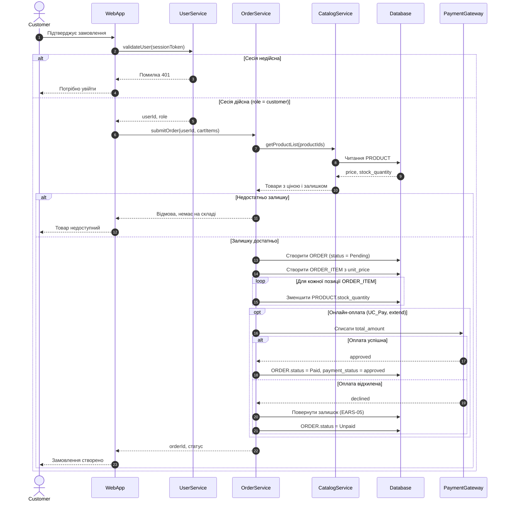

# Sequence-діаграма: оформлення замовлення (UC_CreateOrder)

Деталізує `task-3/spec.md`, розд. 3. Учасники — розд. 2; вимоги — EARS-02..05, EARS-14 (`task-2/README.md`).

## Легенда
- `alt` / `else` — умовні гілки (помилка сесії, нестача залишку, результат оплати).
- `opt` — онлайн-оплата необов'язкова (`<<extend>>` UC_Pay).
- `loop` — резерв по кожній позиції (EARS-03).
- Знімок ціни `unit_price` створюється в тому самому кроці, що й `ORDER_ITEM` (`<<include>>` UC_Snapshot, EARS-02).
- Пишуться назви дій, а не внутрішні деталі: SQL і транзакції не показано, це рівень моделювання, а не реалізації.
- Еталон PlantUML: `task-3/sequence.puml`.
