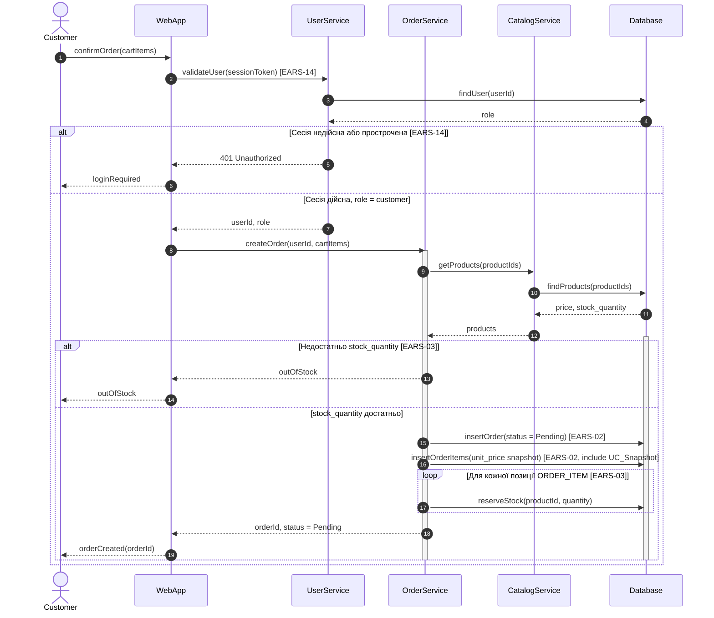
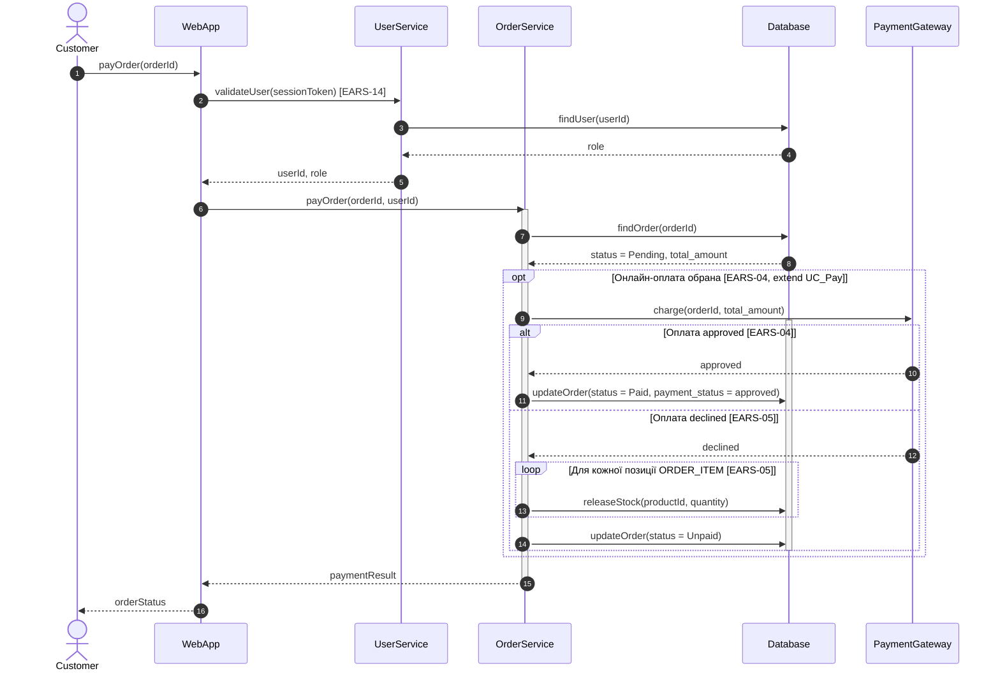

# Sequence-діаграми за сценаріями (Завдання 3)

Деталізують `task-3/spec.md`, розд. 3. Одна діаграма на один сценарій Gherkin з `task-2/README.md`, розд. 3:
- **Діаграма 1 — US-01:** «Створення замовлення з Price Snapshot і резервуванням залишку» (UC_CreateOrder, `<<include>>` UC_Snapshot).
- **Діаграма 2 — US-02:** «Онлайн-оплата як extend, успіх і відмова з поверненням резерву» (UC_Pay, `<<extend>>`).

Еталон PlantUML з тими самими повідомленнями: `task-3/sequence.puml`.

## Діаграма 1. US-01: створення замовлення

## Діаграма 2. US-02: онлайн-оплата

## Легенда
- `alt` / `else` — гілки: сесія (EARS-14), залишок (EARS-03), результат оплати (EARS-04, EARS-05).
- `opt` — онлайн-оплата необов'язкова. Якщо її не обрано, `Payment Gateway` не викликається, `ORDER` лишається `Pending` (сценарій «Оплата не обрана»).
- `loop` — резерв по кожній позиції (EARS-03) і повернення резерву при відмові (EARS-05).
- `include UC_Snapshot` — `unit_price` записується в тому самому кроці, що й `ORDER_ITEM`, поза `opt` (EARS-02).
- `activate` / `deactivate`:
  - Діаграма 1: `OrderService` і `Database` активні від початку `alt Недостатньо stock_quantity` до його кінця.
  - Діаграма 2: `OrderService` активний на всьому виконанні `payOrder`; `Database` активний від початку `alt` (approved/declined) до його кінця всередині `opt`.
- `par` не використано: у сценаріях US-01 і US-02 немає кроків, які виконуються паралельно. Кроки йдуть послідовно за логікою сесії, залишку та оплати.
- Пунктирна стрілка `-->>` — return-повідомлення.
- `PaymentGateway` відсутній на діаграмі 1: сценарій US-01 не містить оплати.
- Не показано: повторну оплату `Unpaid` (EARS-13), автоскасування (EARS-12), SQL і транзакції. Це окремі сценарії або деталі реалізації.
