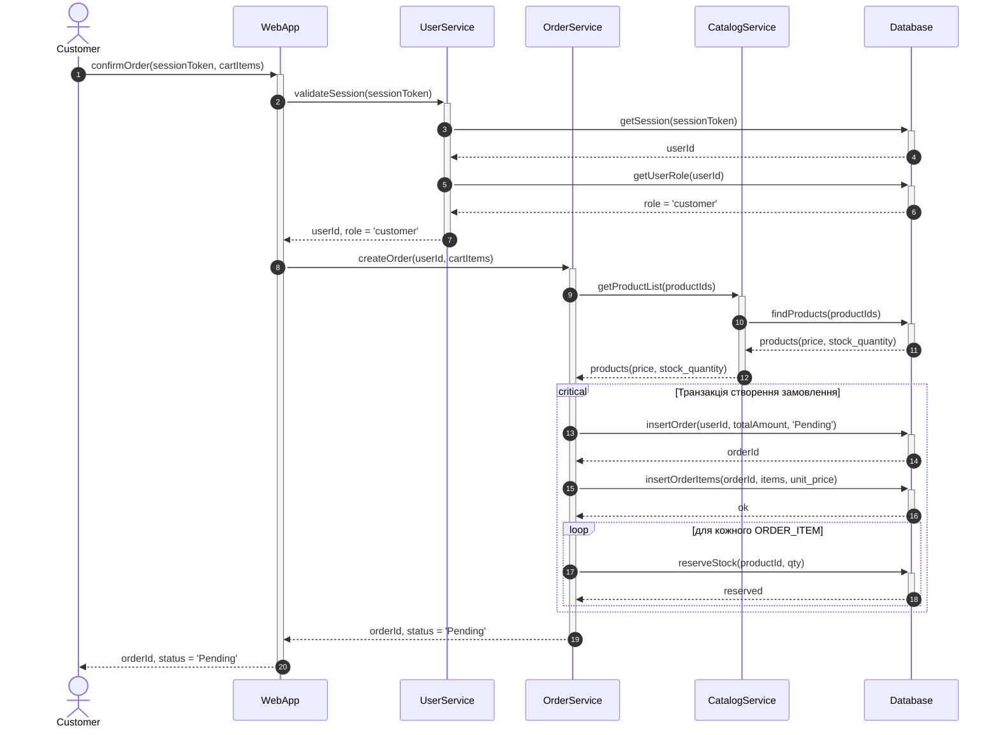
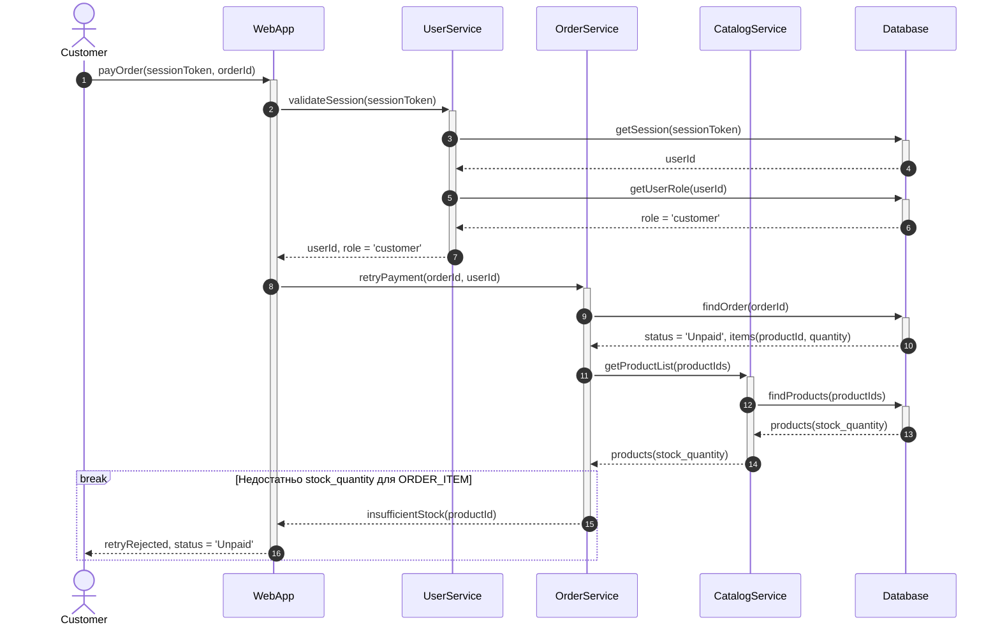
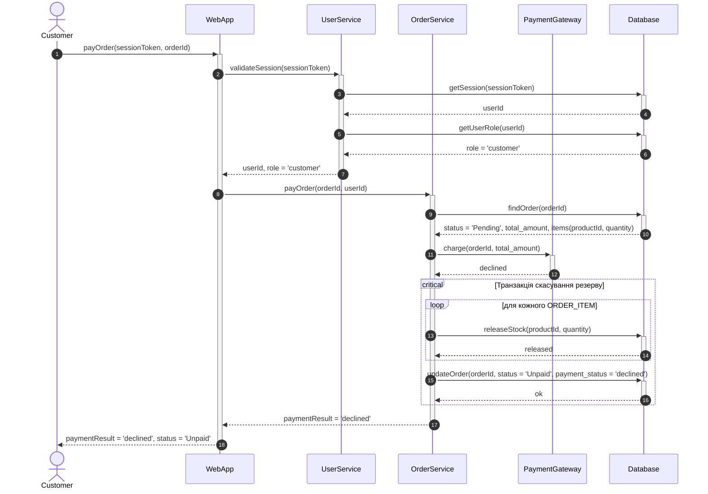
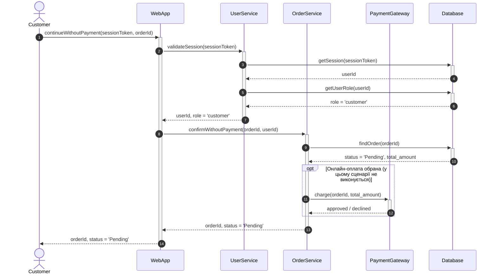

# Sequence-діаграми за сценаріями (Завдання 3)

Деталізують `task-3/spec.md`. Одна діаграма на один Gherkin-сценарій з `task-2/README.md`, розд. 3. Учасники і сигнатури методів — за `docs/adr/0011-sequence-participants-split.md`. Розбиття на окремі діаграми — за `docs/adr/0013-sequence-four-scenarios.md`.

Статус: 4 з 4.

| № | Сценарій (Gherkin, Завдання 2) | Вимоги | Комбінований фрагмент |
|---|---|---|---|
| S1 | US-01: «Створення замовлення з Price Snapshot і резервуванням залишку» | EARS-02, EARS-03, EARS-14 | `critical`, `loop` |
| S2 | US-02: «Повторна оплата відхиляється, якщо товару немає на складі» | EARS-13, EARS-14 | `break` |
| S3 | US-02: «Відмова платежу скасовує резерв» | EARS-04, EARS-05, EARS-14 | `critical`, `loop` |
| S4 | US-02: «Оплата не обрана (extend не виконується)» | EARS-04, EARS-14 | `opt` |

---

## Діаграма 1. S1: успішне оформлення замовлення

**Легенда.** `critical` об'єднує створення `ORDER` і `ORDER_ITEM` з резервуванням в одну транзакцію. `loop` резервує кожну позицію (EARS-03). `unit_price` записується тим самим `insertOrderItems` (EARS-02, include UC_Snapshot).

---

## Діаграма 2. S2: нестача залишку при повторній оплаті

**Легенда.** `break` завершує сценарій, якщо `stock_quantity < ORDER_ITEM.quantity` (EARS-13). Запису в `Database` немає, `ORDER` лишається `Unpaid`, `PaymentGateway` не викликається.

---

## Діаграма 3. S3: відмова онлайн-оплати і скасування резерву

**Легенда.** `critical` містить повернення резерву і зміну статусу, щоб не було частково скасованого замовлення (EARS-05). `releaseStock` повертає `ORDER_ITEM.quantity` у `PRODUCT.stock_quantity`.

---

## Діаграма 4. S4: оформлення без онлайн-оплати

**Легенда.** `opt` показує, що `PaymentGateway` викликається тільки за вибору онлайн-оплати. У цьому сценарії гілка не виконується, `ORDER` лишається `Pending` без змін у `Database`.

---

## Загальні правила

- Кожен виклик має пару `->>+` / `-->>-`. Учасник активний від свого першого виклику до повернення результату.
- Перевірка ролі йде через `Database`: `getSession` і `getUserRole`. Роль не береться без звернення до БД.
- Прозових назв немає. Усі повідомлення є сигнатурами методів.
- Не показано: SQL, індекси, деталі транзакцій поза `critical`, SMS/email.
