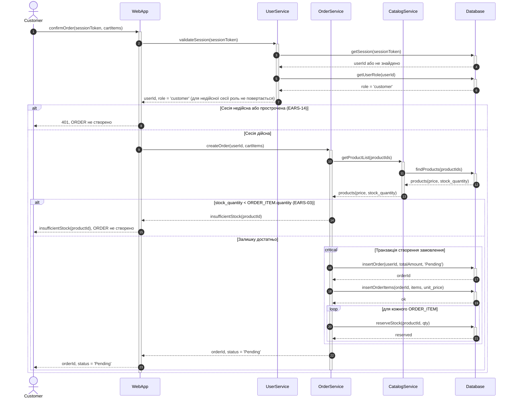
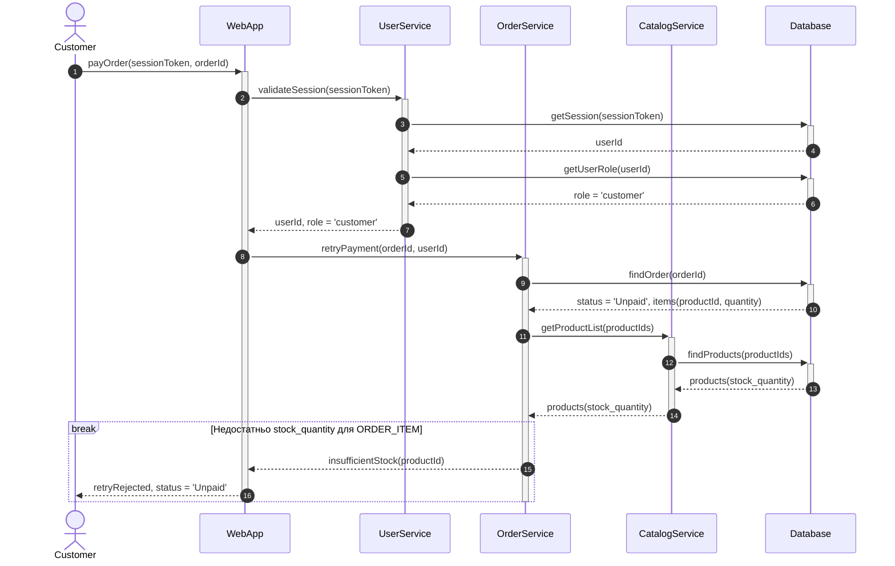
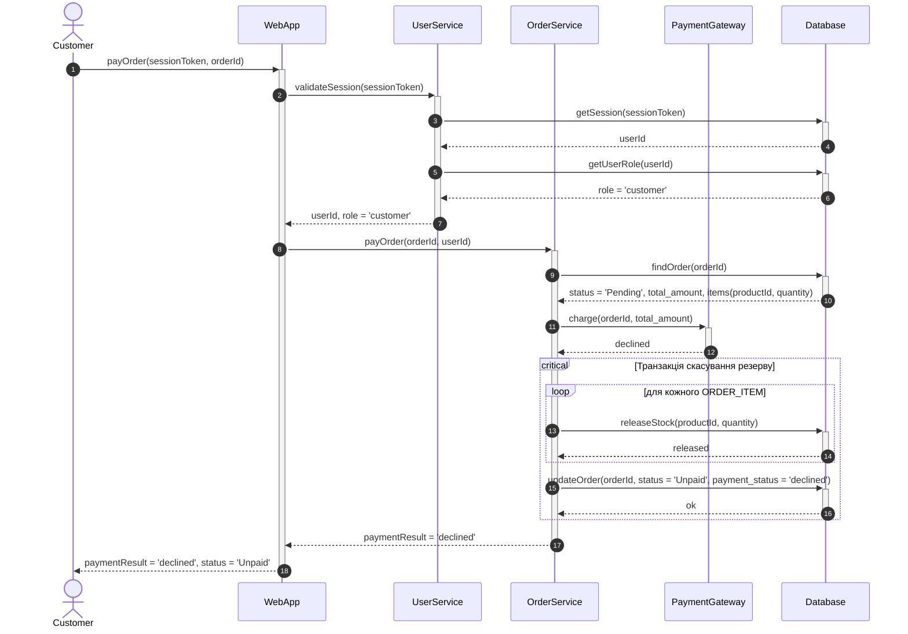
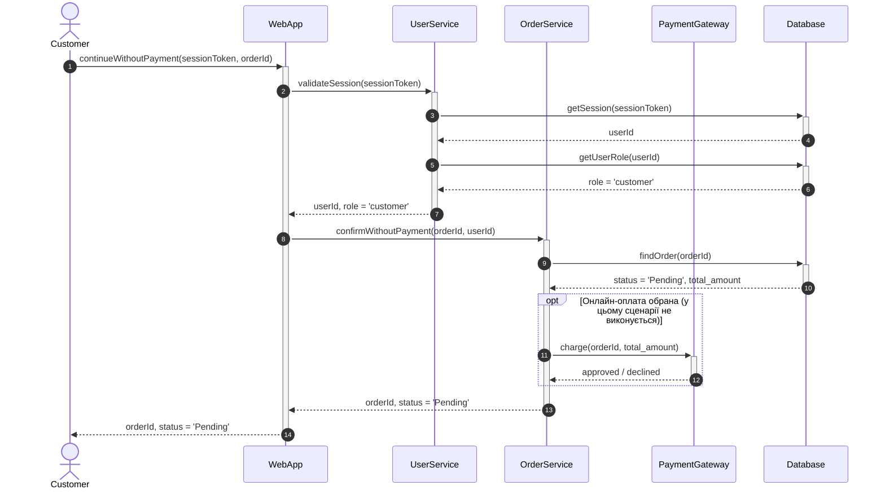
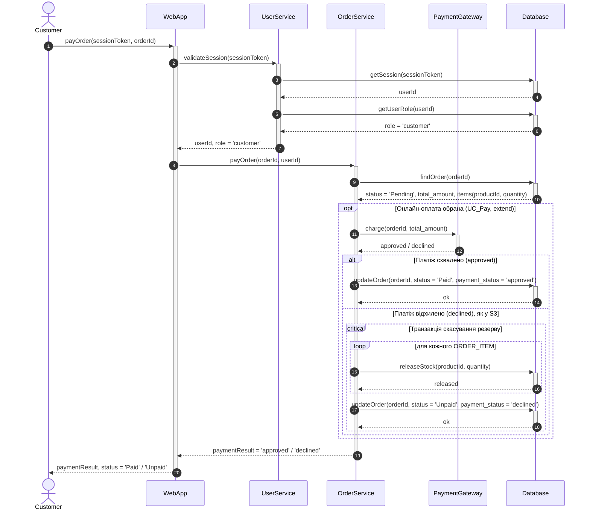
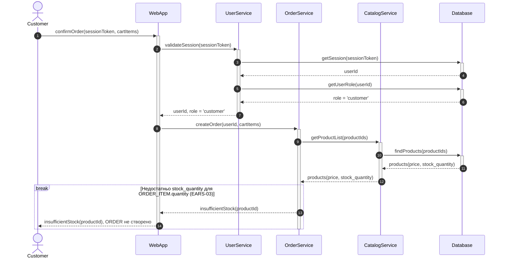
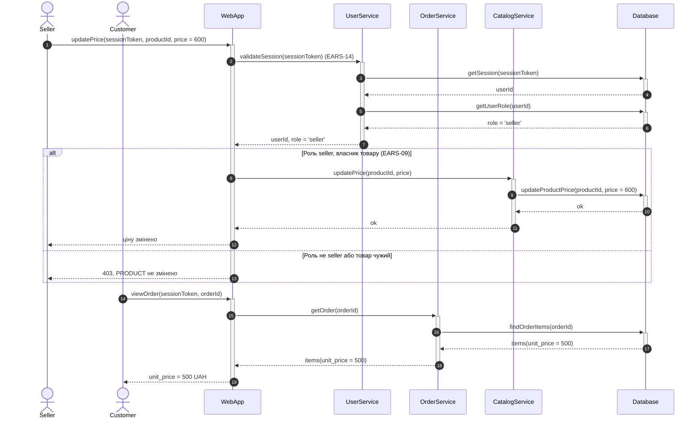
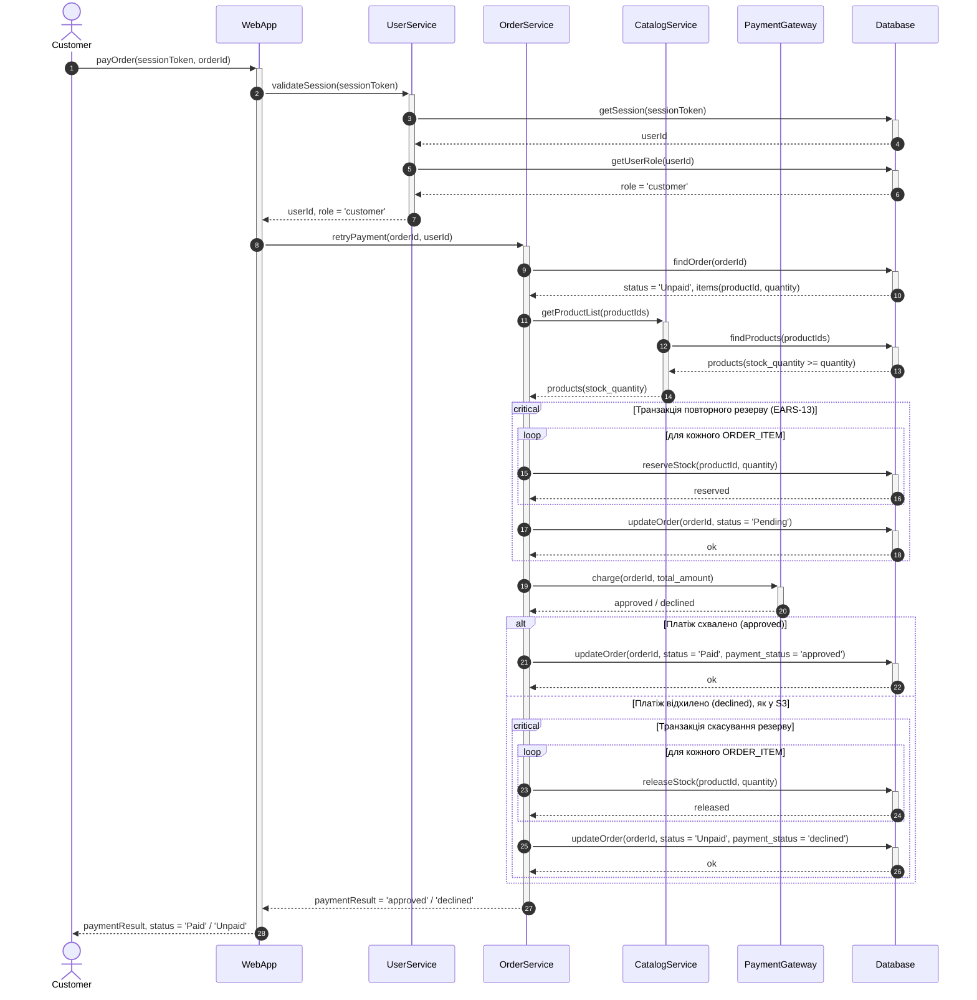

# Sequence-діаграми за сценаріями (Завдання 3)

Деталізують `task-3/spec.md`. Одна діаграма на один Gherkin-сценарій з `task-2/README.md`, розд. 3 (US-01 і US-02, крім сценарію автоскасування через 24 год, який належить `UC_ExpireOrder` і в цю специфікацію не входить). Учасники і сигнатури методів — за `docs/adr/0011-sequence-participants-split.md`. Розбиття на окремі діаграми — за `docs/adr/0013-sequence-four-scenarios.md` (S5–S8 додано за тим самим ADR).

Статус: 8 з 8.

| № | Сценарій (Gherkin, Завдання 2) | Вимоги | Комбінований фрагмент |
|---|---|---|---|
| S1 | US-01: «Створення замовлення з Price Snapshot і резервуванням залишку» | EARS-02, EARS-03, EARS-14 | `alt`, `critical`, `loop` |
| S2 | US-02: «Повторна оплата відхиляється, якщо товару немає на складі» | EARS-13, EARS-14 | `break` |
| S3 | US-02: «Відмова платежу скасовує резерв» | EARS-04, EARS-05, EARS-14 | `critical`, `loop` |
| S4 | US-02: «Оплата не обрана (extend не виконується)» | EARS-04, EARS-14 | `opt` |
| S5 | US-02: «Успішна онлайн-оплата» | EARS-04, EARS-14 | `opt`, `alt`, `critical`, `loop` |
| S6 | US-01: «Оформлення з нестачею залишку» | EARS-03, EARS-14 | `break` |
| S7 | US-01: «Зміна ціни товару після оформлення не впливає на замовлення» | EARS-02, EARS-09, EARS-14 | `alt`, `critical` |
| S8 | US-02: «Повторна оплата після відмови з повторним резервом» | EARS-04, EARS-05, EARS-13, EARS-14 | `critical`, `loop`, `alt` |

---

## Діаграма 1. S1: успішне оформлення замовлення

**Легенда.** `alt` (EARS-14) відокремлює відмову за недійсною або простроченою сесією: `ORDER` не створюється. Активація `WebApp` відкрита до `alt` і закривається один раз після фрагмента. `OrderService` відкривається в гілці «сесія дійсна» і закривається після внутрішнього `alt` (EARS-03). `critical` об'єднує створення `ORDER` і `ORDER_ITEM` з резервуванням в одну транзакцію. `loop` резервує кожну позицію (EARS-03). `unit_price` записується тим самим `insertOrderItems` (EARS-02, include UC_Snapshot).

---

## Діаграма 2. S2: нестача залишку при повторній оплаті

**Легенда.** `break` завершує сценарій, якщо `stock_quantity < ORDER_ITEM.quantity` (EARS-13). Запису в `Database` немає, `ORDER` лишається `Unpaid`, `PaymentGateway` не викликається. Активації `OrderService` і `WebApp` закриваються після `break`.

---

## Діаграма 3. S3: відмова онлайн-оплати і скасування резерву

**Легенда.** `critical` містить повернення резерву і зміну статусу, щоб не було частково скасованого замовлення (EARS-05). `releaseStock` повертає `ORDER_ITEM.quantity` у `PRODUCT.stock_quantity`.

---

## Діаграма 4. S4: оформлення без онлайн-оплати

**Легенда.** `opt` показує, що `PaymentGateway` викликається тільки за вибору онлайн-оплати. У цьому сценарії гілка не виконується, `ORDER` лишається `Pending` без змін у `Database`.

---

## Діаграма 5. S5: успішна онлайн-оплата

**Легенда.** `opt` містить оплату (EARS-04, `<<extend>>` UC_Pay). `alt` розводить результат `PaymentGateway`. При `approved` `ORDER.status` стає `Paid`, `payment_status` — `approved` (`task-2/README.md`, US-02). При `declined` гілка повторює S3: резерв повертається окремими повідомленнями (EARS-05), `ORDER.status` стає `Unpaid`. Активації `OrderService` і `WebApp` починаються до фрагмента і закриваються після нього.

---

## Діаграма 6. S6: нестача залишку при оформленні

**Легенда.** `break` завершує оформлення, якщо `stock_quantity < ORDER_ITEM.quantity` (EARS-03). Запису в `Database` немає: `ORDER`, `ORDER_ITEM` і `PRODUCT.stock_quantity` не змінюються. Gherkin-сценарій — `task-2/README.md`, US-01, «Оформлення з нестачею залишку» (варіант 3 з ADR 0013).

---

## Діаграма 7. S7: зміна ціни після оформлення

**Легенда.** `alt` відокремлює зміну ціни від відмови (EARS-09, EARS-14). `critical` тут не потрібен: одна операція `updateProductPrice`. Частина після `alt` перевіряє, що `ORDER_ITEM.unit_price` лишається 500 UAH (EARS-02): ціна береться з `ORDER_ITEM`, а не з `PRODUCT.price`. Gherkin-сценарій — `task-2/README.md`, US-01, «Зміна ціни товару після оформлення не впливає на замовлення».

---

## Діаграма 8. S8: повторна оплата після відмови з повторним резервом

**Легенда.** `critical` повертає резерв і переводить `ORDER` у `Pending` однією транзакцією (EARS-13). Далі оплата проходить як у S5: `alt` розводить `approved` (`Paid`) і `declined` (резерв повертається, `Unpaid`, EARS-05). Перевірка залишку перед резервом показана як `products(stock_quantity >= quantity)`; відмова за нестачею — S2. `OrderService` і `WebApp` закриваються після фрагментів.

---

## Загальні правила

- Кожен виклик `->>+` має закриття: `-->>-` у тій самій гілці або `deactivate` після фрагмента. Активація учасника, що працює до і після `alt`, відкривається до фрагмента і закривається після нього.
- Пунктирні повернення `-->>` без деактивації використовуються всередині гілок `alt`, `break`, коли закриття виконується один раз після фрагмента.
- Перевірка ролі йде через `Database`: `getSession` і `getUserRole`. Роль не береться без звернення до БД.
- Повідомлення є сигнатурами методів. Українські тексти в мітках фрагментів (`alt`, `opt`, `break`, `critical`) описують умову або назву блоку, а не дію.
- Не показано: SQL, індекси, деталі транзакцій поза `critical`, SMS/email.
- Автоскасування через 24 год (`UC_ExpireOrder`, Gherkin «Неоплачене замовлення скасовується через 24 години») не входить у S1–S8: це окремий UC з `System Timer` (`spec.md`, розд. 4).

**Обмеження Mermaid щодо activation bars.** Mermaid веде activation bars лінійно і не розрізняє гілки `alt`. Якщо учасник активований до `alt` і його закриття стоїть в одній гілці, рендер падає з помилкою `Trying to inactivate an inactive participant`. Тому закриття виконано після фрагмента через `deactivate` (S1, S2, S6, S7, S8), а повернення всередині гілок — пунктирною стрілкою `-->>`. Це відхилення від прикладу з запиту: `UserService-->>-WebApp: 401` всередині `alt` не компілюється.
