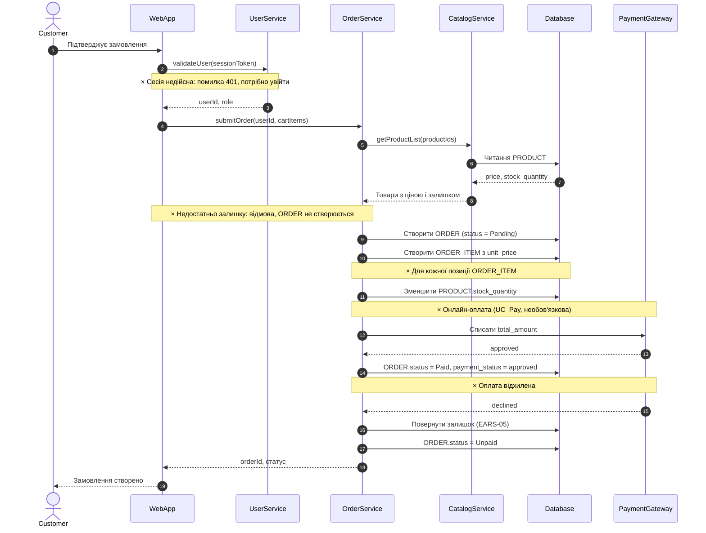

# Sequence-діаграма: оформлення замовлення (UC_CreateOrder)

> **ТИМЧАСОВО:** блоки `alt`, `opt`, `loop` замінено на нотатки «×». Повна версія з гілками — у коміті `416d605`.

Деталізує `task-3/spec.md`, розд. 3. Учасники — розд. 2; вимоги — EARS-02..05, EARS-14 (`task-2/README.md`).

## Легенда
- «×» — місце, де в повній версії були `alt` (умовні гілки), `opt` (необов'язкова оплата) або `loop` (резерв по позиціях).
- Еталон PlantUML: `task-3/sequence.puml` (також у тимчасовій версії).
