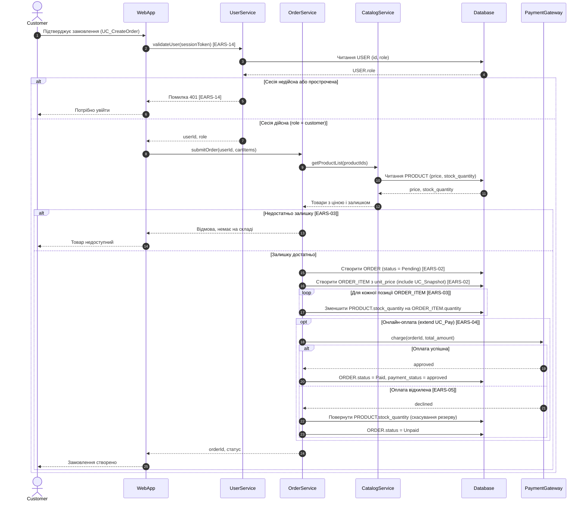

# Sequence-діаграма: оформлення замовлення (UC_CreateOrder)

Деталізує `task-3/spec.md`, розд. 3. Учасники — розд. 2; вимоги — EARS-02..05, EARS-14 (`task-2/README.md`). Еталон PlantUML: `task-3/sequence.puml`.

## Легенда
- `alt` / `else` — умовні гілки: сесія (EARS-14), залишок, результат оплати (EARS-05).
- `opt` — онлайн-оплата необов'язкова (`<<extend>>` UC_Pay, EARS-04).
- `loop` — резерв по кожній позиції (EARS-03).
- `include UC_Snapshot` — знімок `unit_price` створюється в тому самому кроці, що й `ORDER_ITEM` (EARS-02). Включений UC виконується завжди, тому стоїть поза `opt`.
- Пунктирна стрілка `-->>` — return-повідомлення.
- Назви дій, а не внутрішні деталі: SQL і транзакції не показано (рівень моделі, а не реалізації).
