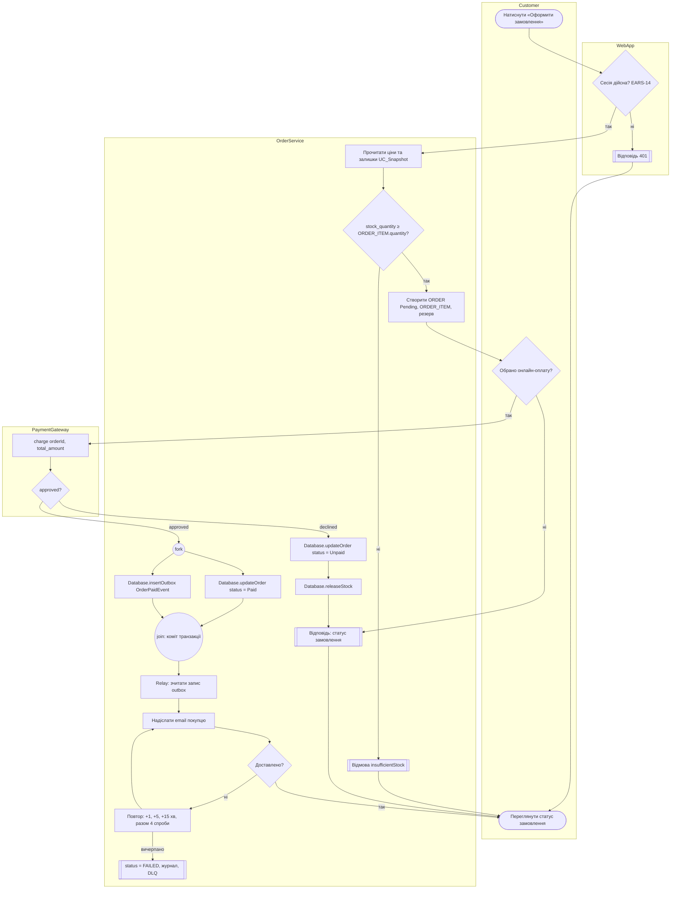

# Activity-діаграма: оформлення та оплата замовлення

Доріжки: `Customer`, `WebApp`, `OrderService` (включно з фоновим Outbox Relay), `PaymentGateway`.
Поза межами цієї діаграми: повторна оплата з `Unpaid` (UC_RetryPayment, EARS-13), повернення коштів, повтори запитів до шлюзу при тайм-ауті.

