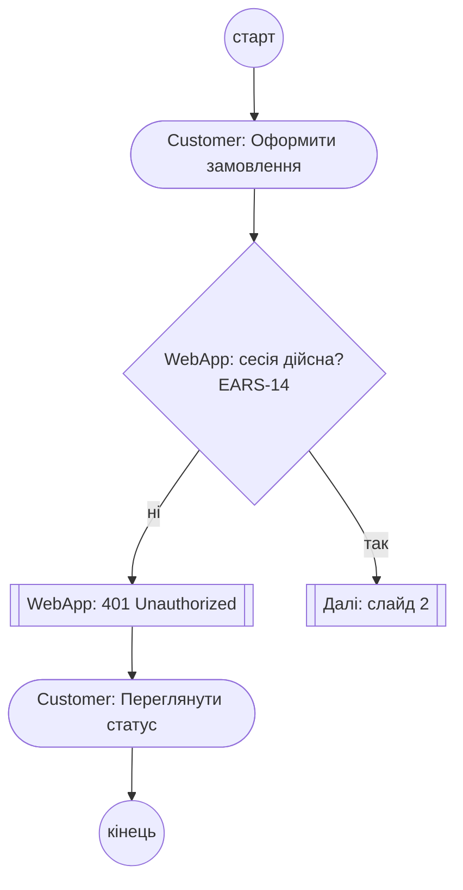
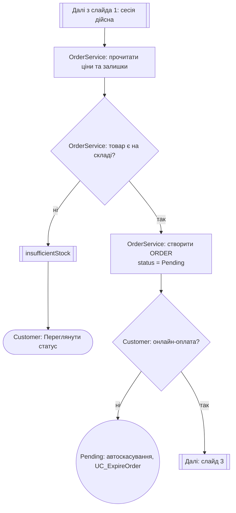
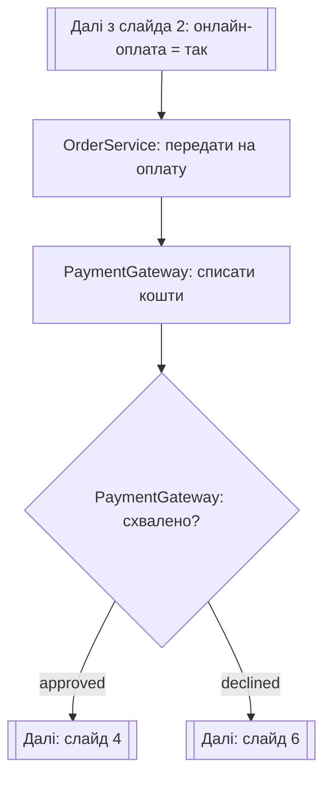
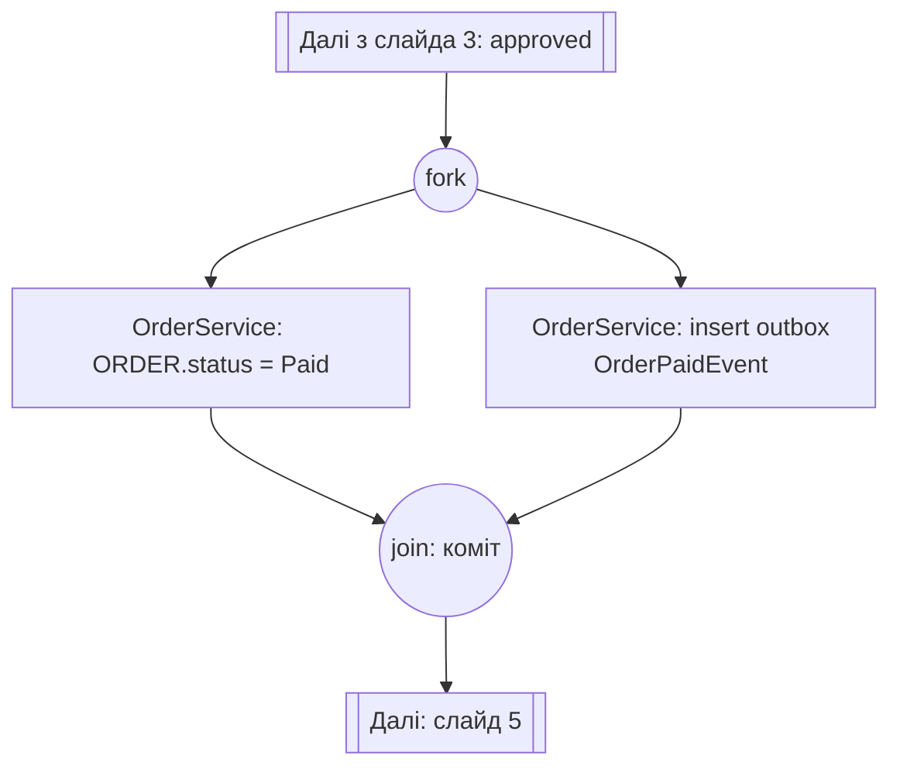
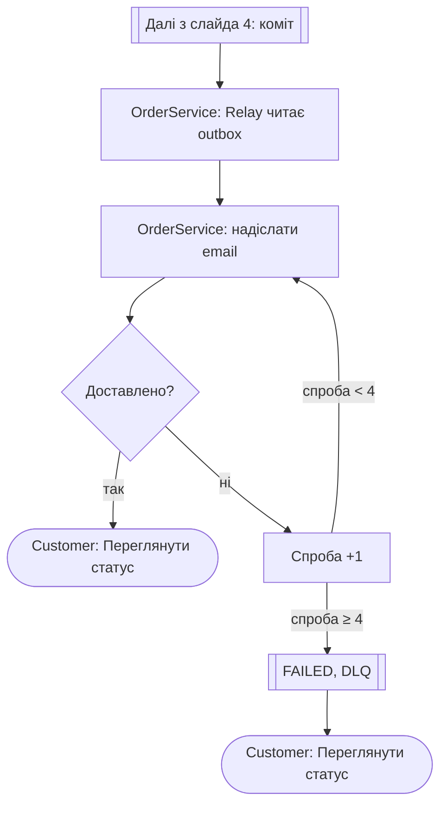
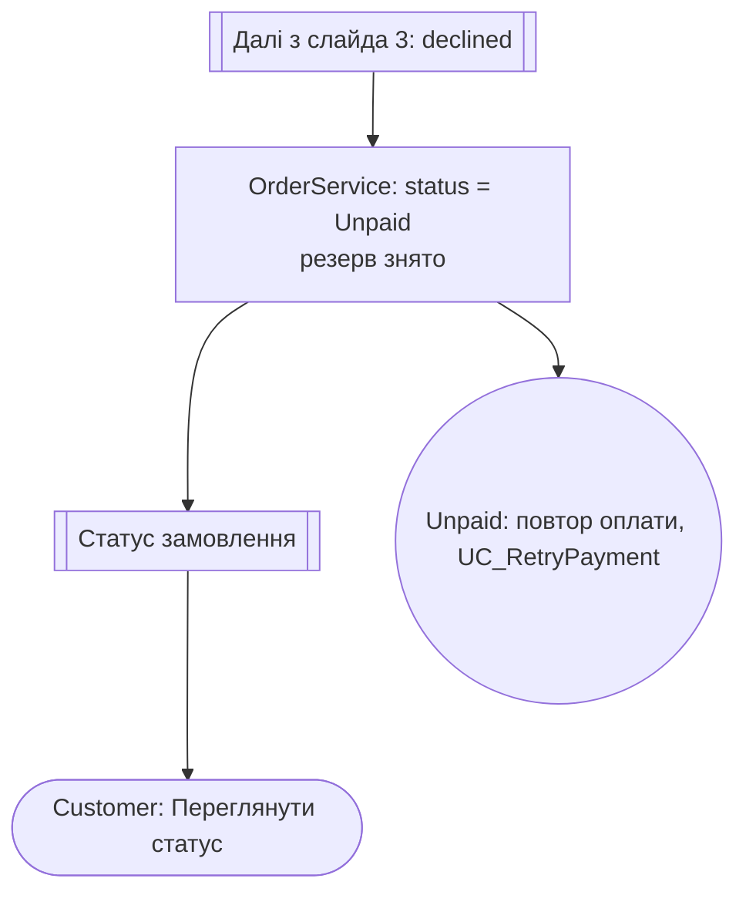

# Activity-діаграма: оформлення та оплата замовлення

Діаграма подана лінійно, слайдами в порядку виконання процесу. Кожен слайд є окремою схемою з одним кроком процесу. Роль виконавця вказано в тексті вузла (префікс `Customer:`, `WebApp:`, `OrderService:`, `PaymentGateway:`). Перехід до наступного слайда позначено вузлом `Далі: слайд N`.

Стани `ORDER`: `Pending` (створення), `Paid` (успішна оплата), `Unpaid` (відмова оплати). Стан `Cancelled` поза цією діаграмою (EARS-12, лише з `Pending`).
Поза межами цієї діаграми: повторна оплата з `Unpaid` (UC_RetryPayment, EARS-13), повернення коштів, повтори запитів до шлюзу при тайм-ауті.

### Слайд 1. Оформлення та перевірка сесії

### Слайд 2. Перевірка товару та створення замовлення

### Слайд 3. Списання коштів

### Слайд 4. Фіксація оплати (атомарна транзакція)

### Слайд 5. Фонове сповіщення (Outbox Relay)

### Слайд 6. Відмова оплати

