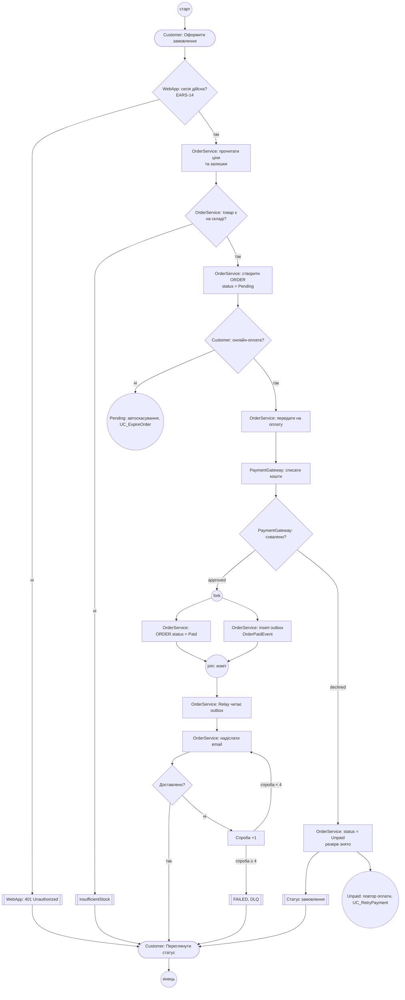

# Activity-діаграма: оформлення та оплата замовлення

Діаграма подана однією лінійною схемою, що читається зверху вниз у порядку виконання процесу. Роль виконавця вказано в тексті вузла (префікс `Customer:`, `WebApp:`, `OrderService:`, `PaymentGateway:`). Групування за доріжками не використано.

Стани `ORDER`: `Pending` (створення), `Paid` (успішна оплата), `Unpaid` (відмова оплати). Стан `Cancelled` поза цією діаграмою (EARS-12, лише з `Pending`).
Поза межами цієї діаграми: повторна оплата з `Unpaid` (UC_RetryPayment, EARS-13), повернення коштів, повтори запитів до шлюзу при тайм-ауті.

