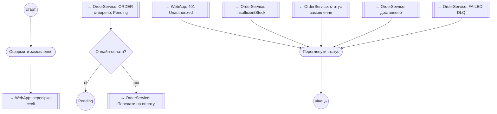
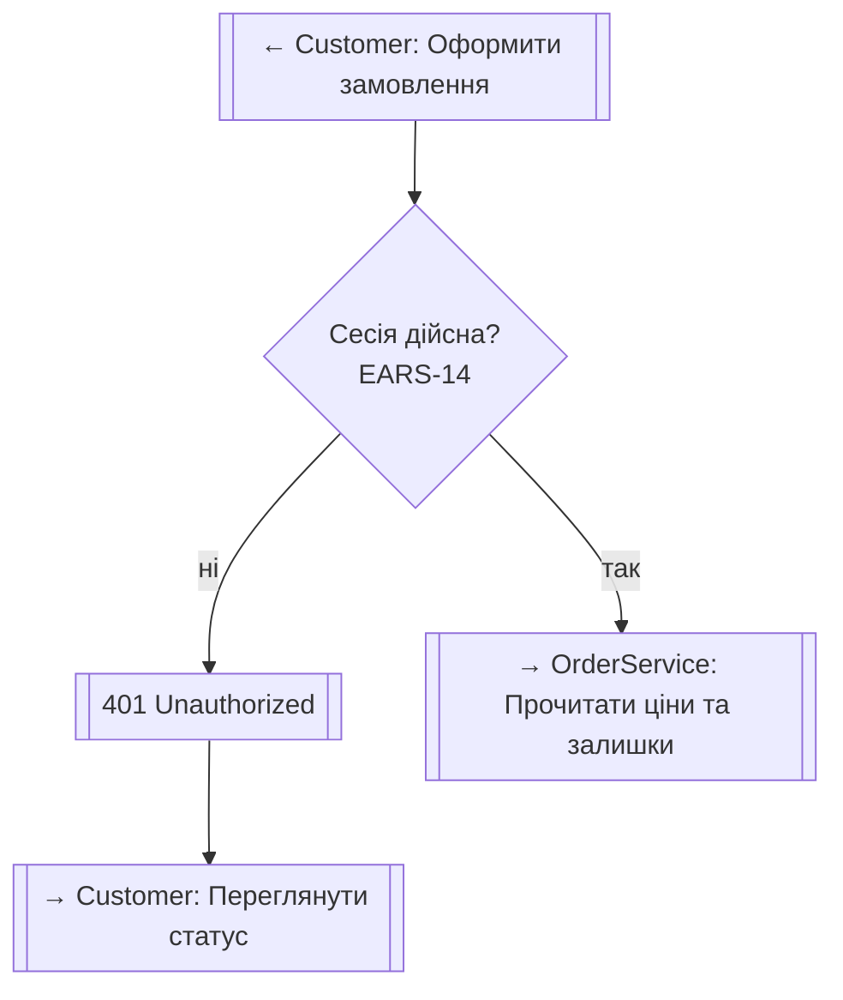
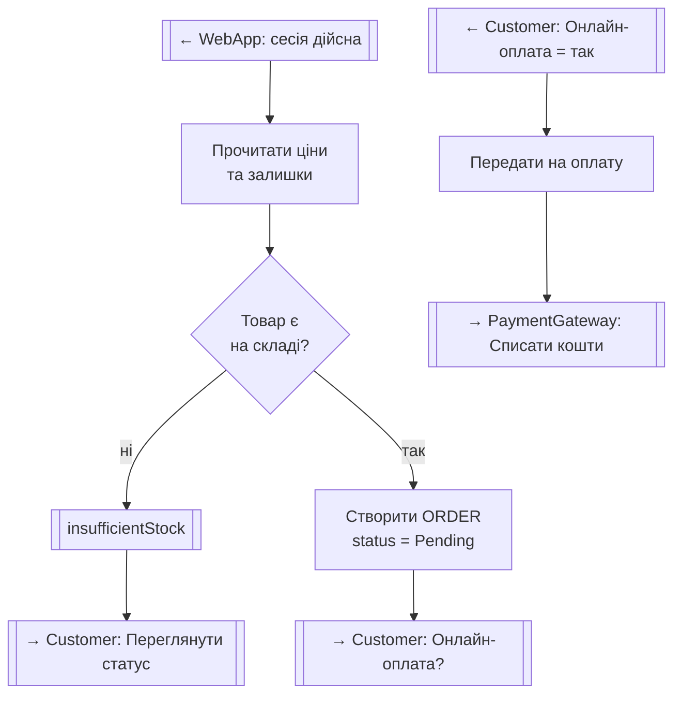
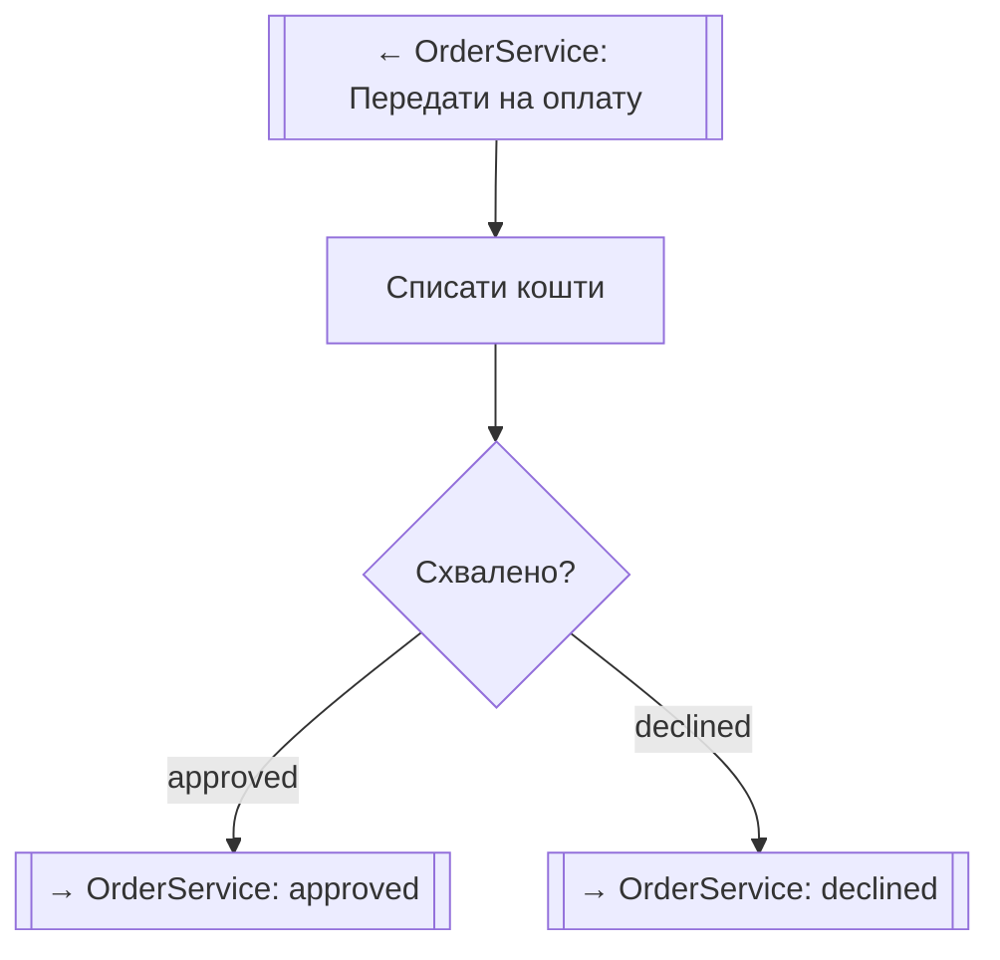
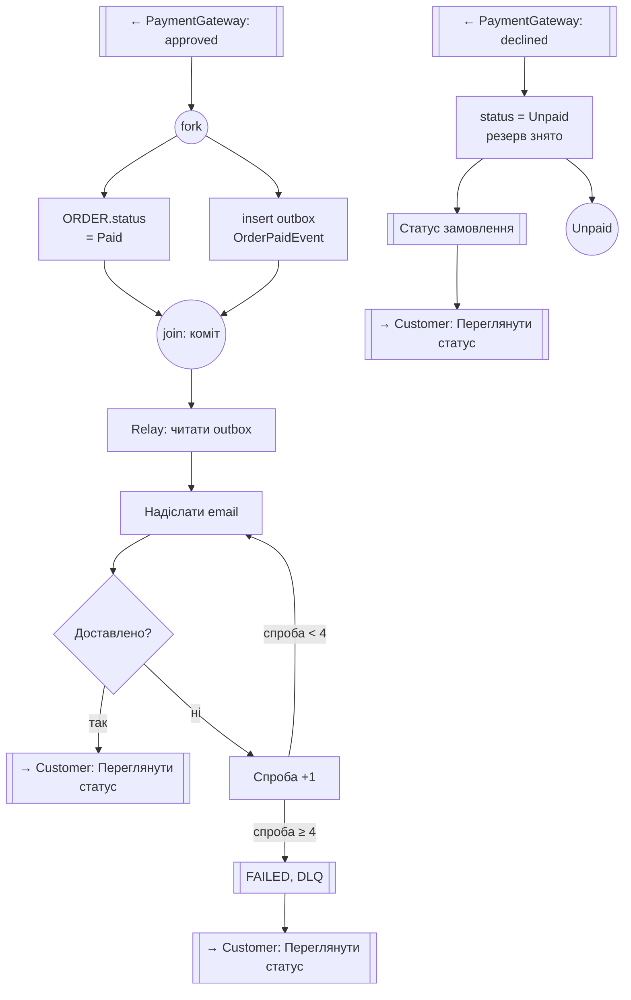

# Activity-діаграма: оформлення та оплата замовлення

Діаграма подана п'ятьма інлайн-блоками в порядку виконання процесу. Перехід між блоками позначено вузлами `→ Доріжка: дія` (вихід) і `← Доріжка: дія` (вхід). Блоки 3 і 5 належать одній доріжці `OrderService`, але розділені етапами: створення замовлення та фіксація оплати.

Доріжки: `Customer`, `WebApp`, `OrderService` (включно з фоновим Outbox Relay), `PaymentGateway`.
Стани `ORDER` позначено в мітках вузлів: `Pending` (створення), `Paid` (успішна оплата), `Unpaid` (відмова оплати). Стан `Cancelled` поза цією діаграмою (EARS-12, лише з `Pending`).
Поза межами цієї діаграми: повторна оплата з `Unpaid` (UC_RetryPayment, EARS-13), повернення коштів, повтори запитів до шлюзу при тайм-ауті.

### Крок 1. Customer: оформлення

### Крок 2. WebApp: перевірка сесії

### Крок 3. OrderService: створення замовлення

### Крок 4. PaymentGateway: списання

### Крок 5. OrderService: фіксація оплати, сповіщення, відмова

