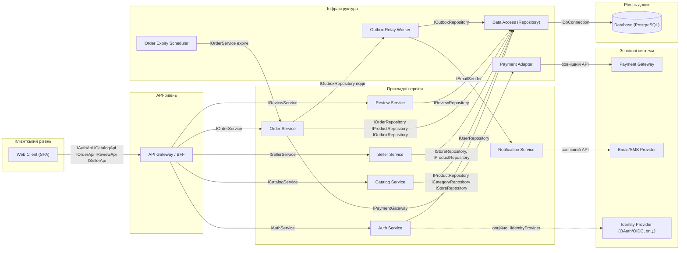

# Component Diagram: архітектура маркетплейсу (Завдання 5)

Діаграма подана як компонентна модель системи. Оскільки Mermaid не має окремої нотації UML Component Diagram, використано `flowchart` з пакетами (`subgraph`) і компонентами; стрілки підписуються іменами provided/required-інтерфейсів. Еталонна UML-версія з льодяниками/розетками інтерфейсів — у `task-5/component.puml`.

## Компоненти та залежності

## Примітки

* `Order Service` реалізує бізнес-логіку Завдання 4: резерв `ORDER_ITEM.quantity`, перехід `Pending → Paid/Unpaid`, запис `OrderPaidEvent` в `outbox` в одній транзакції, повтори (1 + 3) і DLQ.
* `Outbox Relay Worker` зчитує `outbox` після коміту транзакції й ініціює `Notification Service`; збій відправки не відкочує оплату.
* `Order Expiry Scheduler` реалізує EARS-12: `Pending` понад 24 год → `Cancelled` + повернення залишків.
* `Identity Provider` позначено пунктиром як опційна інтеграція (у поточному обсязі автентифікація — за `USER.password_hash`, EARS-11).