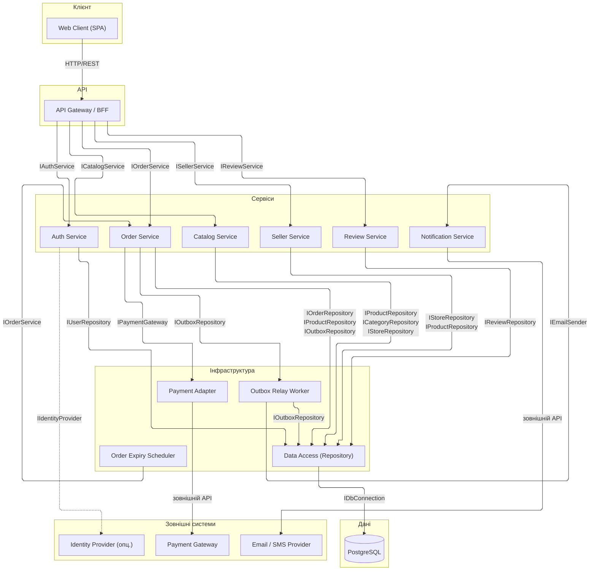

# Component Diagram: архітектура маркетплейсу (Завдання 5)

Діаграма подана як **оглядова** компонентна модель системи (спрощено для читабельності). Детальні provided/required-інтерфейси для кожного зв'язку наведено в таблиці `spec.md` §4. Еталонна повна UML-версія з усіма інтерфейсами (льодяники/розетки) — у `task-5/component.puml`.

## Компоненти та залежності (огляд)

Використано рендерер `elk` з ортогональними стрілками (`step`) та налаштованими відступами, щоб діаграма була широкою, читабельною і без накладань. База даних винесена в окремий підграф `Дані`. Стрілки підписано повними іменами інтерфейсів з перенесенням рядків.

## Примітки

* `Order Service` реалізує бізнес-логіку Завдання 4: резерв, перехід `Pending → Paid/Unpaid`, запис `OrderPaidEvent` в `outbox`, повтори (1 + 3) і DLQ.
* `Outbox Relay` зчитує `outbox` після коміту і ініціює `Notification Service`; збій відправки не відкочує оплату.
* `Expiry Scheduler` реалізує EARS-12: `Pending` понад 24 год → `Cancelled` + повернення залишків.
* `Identity Provider` позначено пунктиром як опційна інтеграція (автентифікація за `USER.password_hash`, EARS-11).
* Детальні інтерфейси (`IOrderService`, `IOrderRepository`, `IPaymentGateway` тощо) — у `spec.md` §4.
* Еталонна повна версія з усіма інтерфейсами — у `task-5/component.puml`.
